# Azzurra's Pro Tennis Challenge

A doubles tennis world tour for the [PRG32](https://github.com/riscv-prg32/PRG32)
RISC-V console, on the 128 KiB cartridge profile, with singles and online
play for up to four consoles.

Azzurra and her partner Viola take on fourteen pairs in fourteen cities, from
Napoli Bay to the final in Athens:

* **Courts:** clay, grass and hard courts, two of them under floodlights.
* **Rules:** real doubles rules, with the serving order, both service boxes,
  faults and lets, deuce and advantage, and a tie-break.
* **Sound:** an original SID-like stereo soundtrack on the title and result
  screens; on court, the sound of the game: racket, bounce, net, line calls
  and crowd.
* **Online:** through the [PRG32 Multiplayer Server](https://github.com/riscv-prg32/PRG32-Multiplayer-Server),
  1 vs 1 between two consoles, or 2 vs 2 with two to four consoles and the
  computer in the free places. Each console sees the court from its own end,
  with the city behind that end.

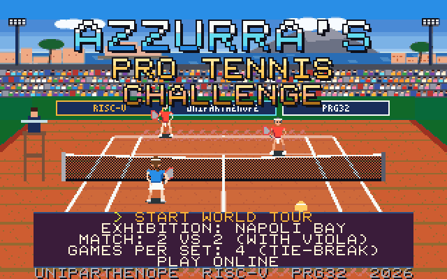

| | |
|:-:|:-:|
| 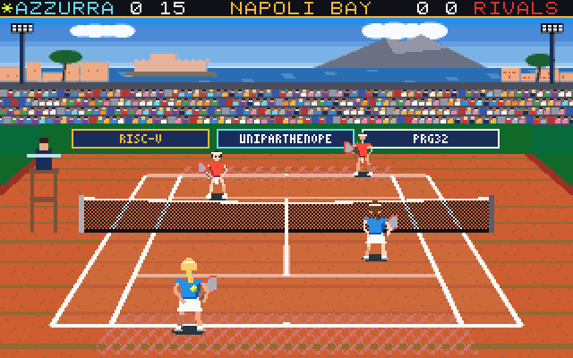 | 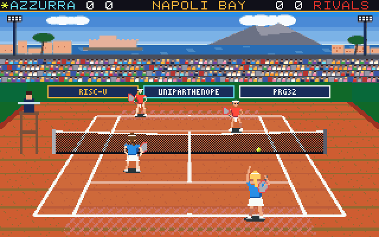 |
| Rally at Napoli Bay (host render) | Serve (QEMU) |
| 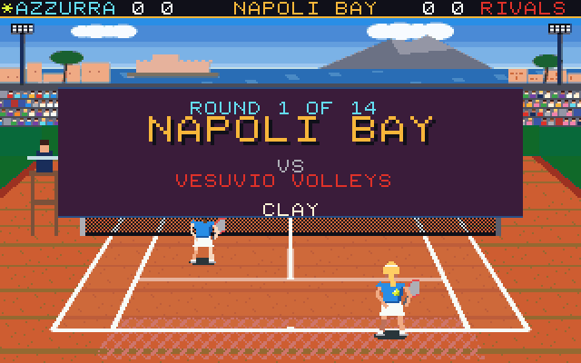 | 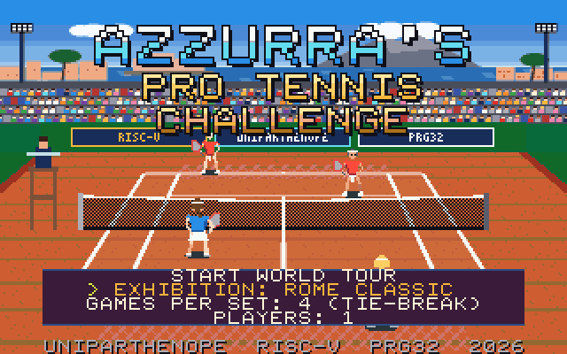 |
| Round intro (QEMU) | Title menu (QEMU) |
| 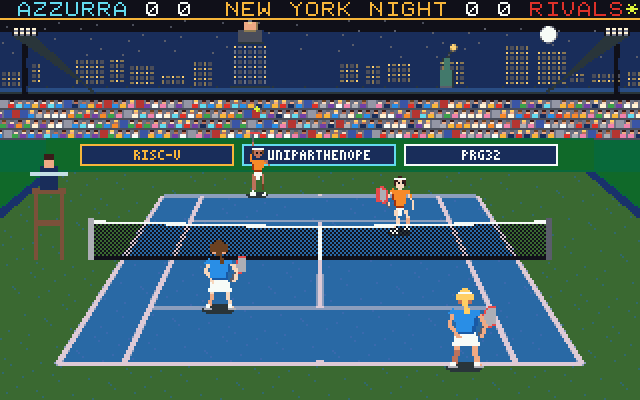 | 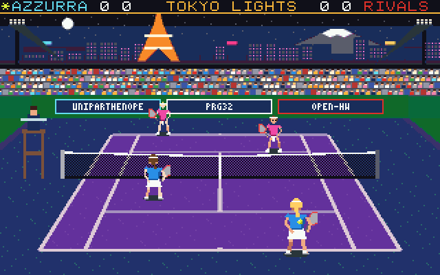 |
| New York Night, under floodlights (host render) | Tokyo Lights (host render) |
| 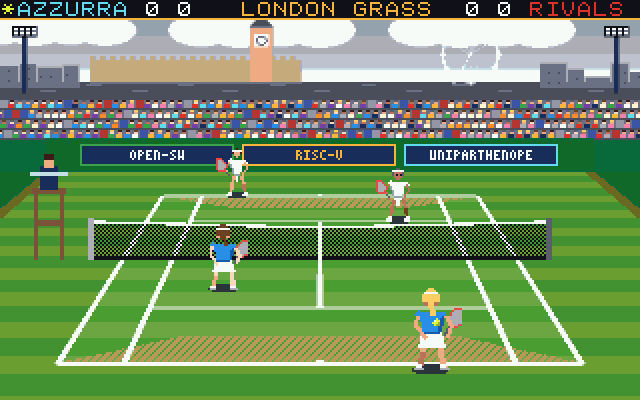 | 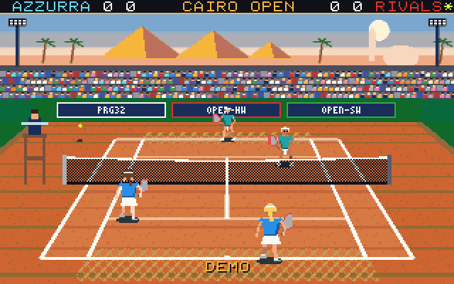 |
| London Grass (host render) | The demo, Cairo Open (host render) |
| 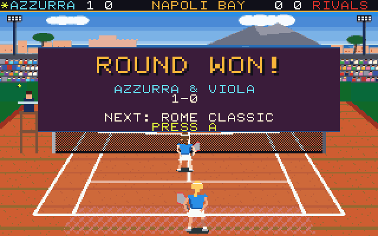 | 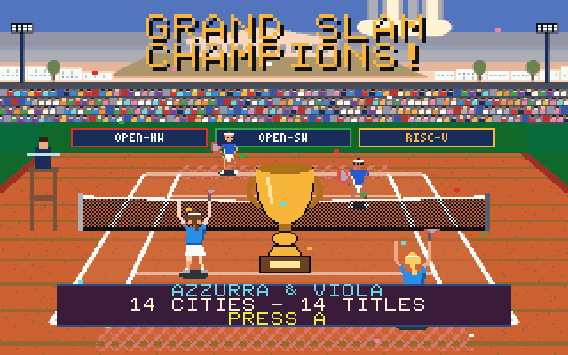 |
| Round won (QEMU) | Grand Slam champions (host render) |
| 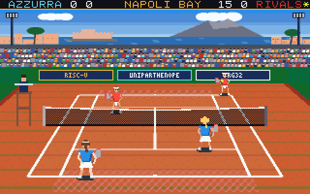 | 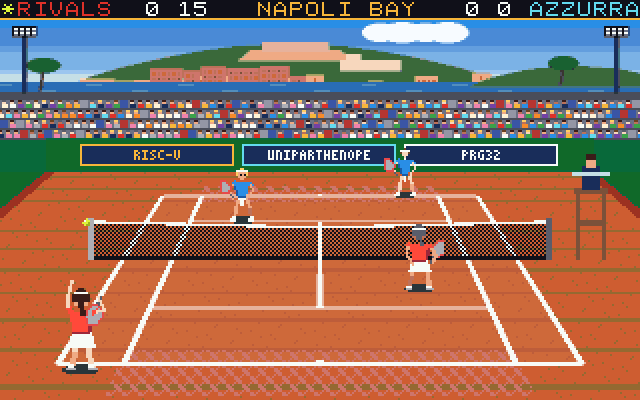 |
| Online 2 vs 2 on four consoles: the near end (QEMU) | The same match from the far end, with the hills behind Napoli (QEMU) |
| 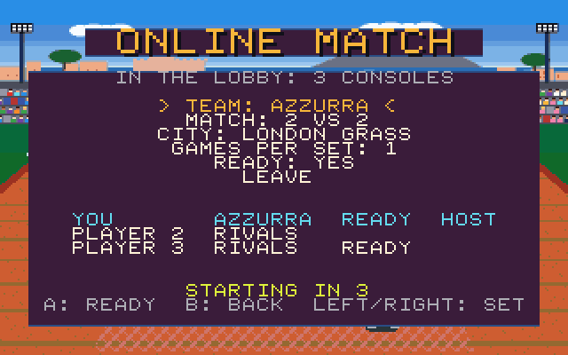 | 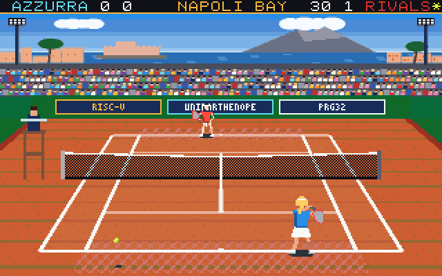 |
| The online lobby, starting (QEMU) | Singles against the computer (ESP32-C6 board) |
| 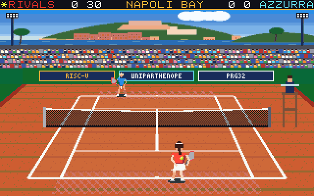 | 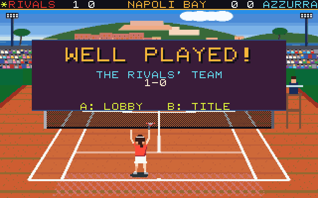 |
| Online 1 vs 1, the board against a QEMU console: the board's view from the far end (ESP32-C6 board) | The same match won on the board (ESP32-C6 board) |

Screens marked **QEMU** were grabbed from the framebuffer of the PRG32 QEMU
firmware running the released cartridge. The **ESP32-C6 board** screens were
taken from a board running it, with `prg32 esp32c6 screenshot`. Screens marked **host render** come
from the same cartridge code run by the host test (`tests/run_tests.sh
shots`). The test proves that the picture is identical on both ESP32-C6 and
QEMU framebuffers.

A one-minute gameplay video, with picture and stereo sound grabbed from QEMU,
is in [`assets/store/preview.mp4`](assets/store/preview.mp4).

## Play

| Input | |
|-------|-|
| D-pad | Run (before the toss: move along the baseline) |
| A | Drive; volley before the bounce; smash a high ball. Serving: toss, then A again at the top |
| B | Lob |
| D-pad while hitting | Aim: left/right across the court, up deep, down short |
| A + B together | Pause: A resumes, B quits to the title. Online there is no pause: a prompt where B leaves the match and A plays on |
| START | Nothing during a match (it is the joystick's centre click) |

The title menu offers:

* **START WORLD TOUR:** fourteen rounds.
* **EXHIBITION:** any city.
* **MATCH:** 1 VS 1, against one computer rival, or 2 VS 2 with Viola.
* **GAMES PER SET:** 1, 2, or 4 with a tie-break.
* **PLAY ONLINE:** the lobby. Choose a team and press READY; the host (the
  first console in the room) chooses the match, the city and the games.

Leave the title alone for 15 seconds to watch a demo match.

The full rules are in [docs/game-design.md](docs/game-design.md).

## Build

You need:

* the [PRG32](https://github.com/riscv-prg32/PRG32) repository next to this
  one, or set `PRG32_REPO` to it;
* Espressif's `riscv32-esp-elf` GCC 14.2.0, which `scripts/build.sh` finds
  under `~/.espressif`;
* Python 3 with Pillow.

```bash
scripts/build.sh
```

This writes:

* `dist/azzurra-pro-tennis-esp32c6.prg32` and
  `dist/azzurra-pro-tennis-qemu.prg32`, Store-ready, with the metadata, icon,
  screenshot and colophon attached;
* `dist/SHA256SUMS`.

The packages are 127,782 bytes (ESP32-C6) and 127,780 bytes (QEMU), of the 131,072 allowed, and use
123,492 of the 131,072 bytes of cartridge memory (measured, from the build logs).

Run the tests (no RISC-V toolchain needed):

```bash
tests/run_tests.sh
```

Run the cartridge in QEMU: screenshots and stereo audio go to
`build/qemu-smoke/`.

```bash
scripts/qemu_preview.py --script smoke --out build/qemu-smoke
```

Pack the Cartridge Store bundle, with the preview video:

```bash
scripts/pack-store-bundle.sh
```

To rebuild everything from scratch, bit for bit (art, music, cartridges,
preview and bundle), follow [docs/reproduce.md](docs/reproduce.md).

## How it works

* **Indexed colour everywhere.**
  * Sprites are 5-bit and backgrounds 6-bit palette indices, coded as
    run-length rows.
  * Each city has a 98-colour palette, solved so that every colour owns its
    own cell of the firmware's colour cube. The ESP32-C6's 8-bit framebuffer
    therefore shows exactly the colours that QEMU shows.
  * See [docs/graphics.md](docs/graphics.md).
* **A row renderer.**
  * The screen is never held whole: each changed row is rebuilt from its
    background, the depth-sorted sprites and the text.
  * Only the changed part of each row is sent, in at most two presents per
    frame.
  * See [docs/architecture.md](docs/architecture.md).
* **Rules in one header.** `src/az_core.h` holds the ball, the lines, the
  scoring and the computer players, in integer arithmetic on 33 ms ticks. It
  is tested on the host by `tests/test_core.c`.
* **Music only where it belongs.** Four original songs play on up to eight
  SID-like voices. During play there is no music, only stereo effects panned
  to where the ball is. See [docs/audio.md](docs/audio.md).

## Status

Release 2.1.0 has been tested:

* on the host: rules, the whole cartridge flow, the repaint invariant, the
  indexed and direct framebuffers, and online play between two to four
  simulated consoles, state-identical at every tick;
* in the PRG32 QEMU firmware: screens, stereo audio, a scripted match to its
  result screen, and online matches between two to four QEMU consoles
  through the real Multiplayer Server, each played to its result;
* on an ESP32-C6 board: uploaded over USB, the title, the demo, a singles
  and a doubles exhibition, the pause and the result screen, and an online
  1 vs 1 against a QEMU console, played to its result on both (the board
  found the server on the LAN by itself);
* by the Cartridge Store's own bundle check.

On the board, no frame rate has been measured. See
[docs/testing.md](docs/testing.md).

## Documentation

[docs/index.md](docs/index.md) · [CHANGELOG.md](CHANGELOG.md) ·
[AGENTS.md](AGENTS.md) (for maintainers and coding agents)

## Credits

* **Design, code, art and music:** Raffaele Montella (UniParthenope).
* **Code adapted from other PRG32 cartridges:** the row compositor, the
  palette solver, the tracker and the QEMU capture tools come from The
  Trerrote Connection, Drumfight Napoli 97 and other PRG32 cartridges (MIT);
  see `metadata/colophon.json`.

## License

MIT. See [LICENSE](LICENSE).
